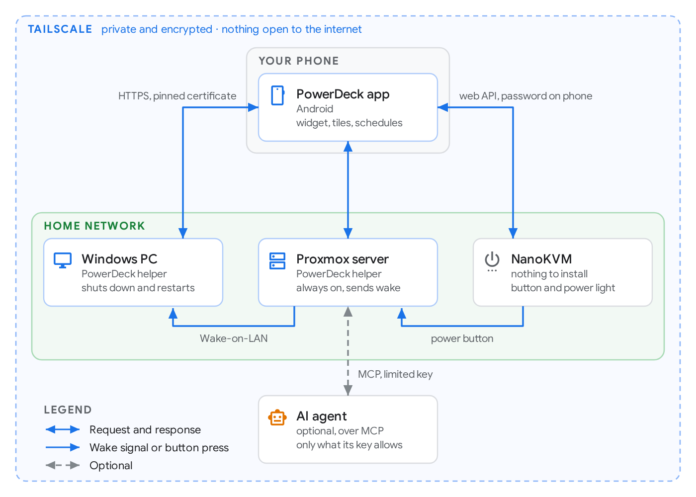

<p align="center">
  
</p>

<p align="center">
  <a href="https://github.com/ProjectZero02/powerdeck/releases/latest"></a>
  <a href="https://github.com/ProjectZero02/powerdeck/releases"></a>
  <a href="https://github.com/ProjectZero02/powerdeck/actions/workflows/build.yml"></a>
  
  <a href="LICENSE"></a>
</p>

<p align="center">
  <b><a href="#set-up-in-3-steps">Set up</a></b> ·
  <a href="#features">Features</a> ·
  <a href="#how-it-works">How it works</a> ·
  <a href="#safe-by-design">Safety</a> ·
  <a href="#ai-agents-mcp">AI agents</a> ·
  <a href="#troubleshooting">Troubleshooting</a>
</p>

---

**PowerDeck** turns your PCs and servers on, off and restarts them from an Android phone, at home or anywhere else. It's free, open source, and needs no port forwarding, cloud account or subscription. Everything travels over your own [Tailscale](https://tailscale.com) network.

- **One command per computer.** Windows and Linux (including Proxmox) set themselves up: service, firewall, Wake-on-LAN, Fast Startup.
- **Finds everything itself.** Add one computer, and the others, plus any NanoKVM, show up ready to add.
- **Careful by default.** Shutdowns count down for 60 seconds and can be cancelled. PowerDeck asks first if someone's using the computer, and it never presses a power button blind.

## Set up in 3 steps

> [!IMPORTANT]
> You need **[Tailscale](https://tailscale.com/download)** (free for personal use) on your phone and on every computer, **signed in to the same account**. That's how your phone reaches your computers from anywhere, and how PowerDeck knows they're yours.

**1. Install the helper on each computer**

**Windows**: in **PowerShell**

```powershell
irm https://github.com/ProjectZero02/powerdeck/releases/latest/download/install.ps1 | iex
```

**Linux / Proxmox**: in a **terminal**, as root or as any user with sudo

```sh
curl -fsSL https://github.com/ProjectZero02/powerdeck/releases/latest/download/install.sh | sh
```

Both installers check the download against the release's checksums (on Linux, its Ed25519 signature too), set everything up and show a **QR code**. On Windows, PowerDeck's window walks you through three skippable steps: a code to download the app, a code to add the PC, and its setup checks (with an option to keep an icon in the taskbar's hidden icons). On Linux the code is printed in the terminal (`powerdeck-helper qr` shows it again). They also tell you about anything they can't fix themselves, such as a BIOS setting. Prefer a regular installer on Windows? Download [PowerDeck-Setup.exe](https://github.com/ProjectZero02/powerdeck/releases/latest/download/PowerDeck-Setup.exe).

**2. Install the app on your phone**

Download [**PowerDeck.apk**](https://github.com/ProjectZero02/powerdeck/releases/latest/download/PowerDeck.apk) on the phone (the Windows window has a QR code for it) and open it. Android asks once to allow installs from your browser.

**3. Scan the code**

Tap **Scan the helper's code** and allow the camera, then name the computer and tap **Add**. Your other computers and NanoKVMs then appear under **Found on your tailnet**: tap **Add** on each one. A NanoKVM asks for its password and which computer's power button it's wired to.

> [!NOTE]
> A NanoKVM shows up only once it's on Tailscale too: turn Tailscale on in its web settings and sign it in to the same account. Keep its web page on plain HTTP (the default); Tailscale already encrypts the connection.

That's it. Try **Turn on** once while the computer is off to confirm Wake-on-LAN works.

<details>
<summary><b>Windows says "Windows protected your PC"</b></summary>

The installer isn't code-signed yet, so SmartScreen warns about it. Choose **More info → Run anyway**. Every release is built by GitHub Actions straight from this repository and comes with checksums, Ed25519 signatures and a [build attestation](#checking-a-download).
</details>

<details>
<summary><b>Always-on computers: turn off Tailscale key expiry</b></summary>

Tailscale signs devices out every 180 days by default. For a server, or anything PowerDeck wakes up, open the [Tailscale admin console](https://login.tailscale.com/admin/machines), click **⋯** → **Disable key expiry** on that machine.
</details>

## Screenshots

<p align="center">
  
  
  
  
</p>
<p align="center"><sub>Every device at a glance · Setup checks, schedules and history · Found on your tailnet · Dark mode and Material You</sub></p>

## Features

- **On · Off · Restart.** Clean shutdowns with a countdown you can cancel (60 seconds by default; set it, and whether buttons need a 3-second hold, in Settings). On Windows, **Update and shut down** when updates are waiting.
- **Turn on from anywhere.** Wake-on-LAN, sent by any PowerDeck computer on the same home network (an always-on server is ideal), or by a NanoKVM, or by your phone when it's at home.
- **NanoKVM.** Wire a [NanoKVM](https://github.com/sipeed/NanoKVM) to any computer's power and reset buttons to turn it on even where Wake-on-LAN can't, to shut it down when its helper doesn't answer, and to **reset a frozen computer**. An always-on PowerDeck computer (a home server, say) drives the KVMs for the app, and learns on its own which cables are connected. Nothing is installed on the KVM.
- **Someone using it?** Shutdowns and restarts ask first when someone is active or a game is full-screen, and say who.
- **Proxmox aware.** Shows running VMs. A shutdown stops them cleanly first.
- **Schedules.** Shut down, restart or wake at set times on chosen days, skipped while the computer is in use.
- **Setup checks.** Each device reports what's wrong, with a **Fix** button where it can fix it remotely (Wake-on-LAN, Fast Startup, firewall, Tailscale unattended mode).
- **Shortcuts.** A home-screen widget with every device, four Quick Settings tiles, home-screen shortcuts per device, and long-press shortcuts on the app icon.
- **Notifications.** When a schedule or an agent acts, or a device goes offline.
- **History.** Who did what and when, on every device.
- **Tidy up from the phone.** Each device card's **⋮** menu renames, opens settings, adds a home-screen shortcut, or deletes it: from the phone only, or also uninstalling PowerDeck from that computer.
- **Updates.** Computers update themselves with signed releases, 3 days after a release is out (never during a countdown); pause that for a week from a device's page. Servers (Linux) start with it off. Turn it on or off, or **Update devices now**, from the app's settings. The app tells you when a new version of itself is out.
- **AI agents.** Let an agent or a script check and control your devices over [MCP](https://modelcontextprotocol.io), within limits you set.
- **Other people's computers.** A device on another Tailscale account can be added with a one-time 8-character pairing code.

## How it works

<p align="center">
<picture>
  <source media="(prefers-color-scheme: dark)" srcset="docs/images/how-it-works-dark.png">
  
</picture>
</p>

**The helper** is a small Go service (about 10 MB) on each computer. It answers only Tailscale addresses. It shuts its own computer down or restarts it, sends Wake-on-LAN to computers on its network, and finds the other PowerDeck devices on your tailnet. **The app** talks to each helper directly; there's no server in between. A computer that's off can't answer, so the app asks something that's still on (another helper, a NanoKVM, or the phone itself) to wake it.

What the installer sets up:

- **Windows:** a service that starts before anyone signs in; a firewall rule that admits only Tailscale addresses; Wake-on-LAN on the wired network card, and Fast Startup off so "shut down" is a real power-off; Tailscale's unattended mode, so the PC is reachable at the sign-in screen.
- **Linux:** a systemd service that answers only Tailscale addresses and loopback; Wake-on-LAN armed with `ethtool` at every start.
- **Both:** the helper listens only on loopback and the Tailscale addresses; updates are checked against an Ed25519 signature (automatic on Windows, off by default on Linux).

Your BIOS also needs Wake-on-LAN enabled. On many boards that's *ErP Ready: Disabled* and *Power On By PCI-E: Enabled*. For a server, also turn on *Restore on AC power loss* so it comes back after a power cut.

## Safe by design

- **Only you.** A helper asks Tailscale who's calling and trusts only its **owner devices**: the phones and computers that scanned its code (the code works once, for 10 minutes) or that you added on the machine with `powerdeck-helper owner add`. Another device on your Tailscale account isn't trusted just for being there. A phone on another account that enters the code can turn that one device on and off, but can't change its settings or reach your other devices. Your computers reach each other with keys the app sets up, which can power them on and off and nothing more.
- **No accidental power-offs.** A KVM press toggles power, so PowerDeck presses to turn on only when the computer's helper doesn't answer *and* the power light reads off. It won't press at all until it has seen that computer's light on, which proves the LED cable is connected (an unwired LED always reads off). Linking a KVM checks that its light matches the computer. Reset and holding the button down to force a computer off are hidden behind a confirmation, refused while the computer still answers, and only for your own devices, never an agent.
- **Nothing exposed.** No ports are opened to the internet. Phone-to-helper traffic is HTTPS pinned to that helper's own certificate, inside Tailscale's WireGuard tunnel.
- **Your NanoKVM password stays with you,** encrypted on your phone with a key in Android's hardware keystore (the app is excluded from backups), and sealed on the one PowerDeck computer that drives the KVM, with a key apart from its data. [Give PowerDeck its own NanoKVM account](docs/nanokvm-hardening.md) rather than `admin`.
- **Checked downloads.** Automatic updates and the Linux installer verify an Ed25519 signature; the Windows one-liner checks the release's SHA-256. Android accepts updates only when they're signed with the same key. Every release has SHA-256 checksums and a GitHub build attestation.

Details: [SECURITY.md](SECURITY.md) · protocol: [docs/protocol.md](docs/protocol.md)

## AI agents (MCP)

Let an AI agent or a script check and control your devices through [MCP](https://modelcontextprotocol.io). In the app, open an always-on device (a home server is ideal), tap **Set up** next to **Allow AI agents to use this device**, then **Create a key**. Choose which devices it may use and whether it may shut them down, then paste the config it shows into your agent:

```json
{"mcpServers": {"powerdeck": {"type": "http", "url": "http://<server's tailnet address>:47323/mcp",
  "headers": {"Authorization": "Bearer pdk_…"}}}}
```

Port 47323 is plain HTTP for agents that can't pin a self-signed certificate. It's only reachable over Tailscale, which encrypts it end to end. If your agent can pin a certificate, use `https://<server>:47321/mcp` instead.

Tools: `list_devices`, `get_status`, `power_on`, `power_off`, `cancel`. On the hub that drives your NanoKVMs, also `list_machines` and `get_events` (what the hub sees, including frozen machines), `propose_reset` and `propose_force_off` (ask you to reset a frozen machine), `get_recovery` and `withdraw_recovery`. Whatever the agent asks for, the helper enforces these limits:
- only the devices and permissions on its key;
- never while someone is using the computer, and always with the 60-second countdown;
- at most one shutdown per device per 10 minutes;
- never the computer the agent itself runs on;
- an agent never resets or forces off a computer itself. It asks, and nothing is pressed until you tap **Reset** on your phone.

The key works only from the first device that uses it. Every action appears in History and in a notification on your phone. Each device's **Allow AI agents** switch turns agents away from it at any time: they can still see whether it's on, but can't turn it on or off.

Connecting your own assistant, with REST, live events and webhooks too: [docs/integrating-an-assistant.md](docs/integrating-an-assistant.md). Testing it all on real hardware: [docs/hardware-test.md](docs/hardware-test.md).

## Troubleshooting

<details>
<summary><b>A device shows Off, but it's on</b></summary>

Check that Tailscale is connected on both the phone and the computer, then look at the device's setup checks in the app. Logs: Windows `C:\ProgramData\PowerDeck\logs\`, Linux `journalctl -u powerdeck`.
</details>

<details>
<summary><b>Turn on does nothing</b></summary>

- The computer must be connected by **cable**; Wi-Fi can't wake a computer that's off.
- Wake-on-LAN must be enabled in the **BIOS** (see above), and the **Wake-on-LAN** and **Fast Startup** setup checks must be green.
- Something on that home network has to be on to send the signal: another PowerDeck computer, a NanoKVM, or your phone while it's on home Wi-Fi.
</details>

<details>
<summary><b>Windows is reachable only after someone signs in</b></summary>

Fix the **Tailscale unattended** setup check (one tap on **Fix**).
</details>

<details>
<summary><b>"This device belongs to another Tailscale account"</b></summary>

The phone and the computer are signed in to different Tailscale accounts. Either sign them in to the same one, or enter the pairing code the computer shows: on Windows it's in the PowerDeck window, on Linux run `powerdeck-helper qr`.
</details>

<details>
<summary><b>An always-on device drops off after a few months</b></summary>

That's Tailscale key expiry. In the Tailscale admin console, **Disable key expiry** for it.
</details>

<details>
<summary><b>Uninstalling</b></summary>

- **Windows:** Settings → Apps → PowerDeck → Uninstall. This also deletes its keys and settings; if you reinstall, remove the PC in the app and add it again.
- **Linux:** `curl -fsSL https://github.com/ProjectZero02/powerdeck/releases/latest/download/install.sh | sh -s -- --uninstall` (add `--purge` to delete its data too).
- **Phone:** uninstall the app as usual.
</details>

### Checking a download

Each release lists SHA-256 checksums in `SHA256SUMS.txt`, and GitHub can confirm a file was built here:

```sh
gh attestation verify PowerDeck-Setup.exe --repo ProjectZero02/powerdeck
```

## Building from source

| Part | Stack | Test |
|---|---|---|
| [`helper/`](helper) | Go, no CGO; Windows installer with Inno Setup | `go test ./...` · `go run ./tools/demo` shows the Windows window with sample data |
| [`android/`](android) | Kotlin, Jetpack Compose (Material 3), Glance widget | `./gradlew testDebugUnitTest`: unit tests plus Roborazzi screenshots (the images on this page) |

CI ([`build.yml`](.github/workflows/build.yml)) runs every test. It also installs and uninstalls the real helper on Windows and Linux runners, including a real scheduled shutdown that's then cancelled. Pushing a `vX.Y.Z` tag publishes a signed release.

## Contributing

Bug reports, ideas and pull requests are welcome. See [CONTRIBUTING.md](CONTRIBUTING.md), and report security issues privately as described in [SECURITY.md](SECURITY.md).

## License

[MIT](LICENSE) © 2026 ProjectZero02
