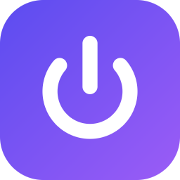
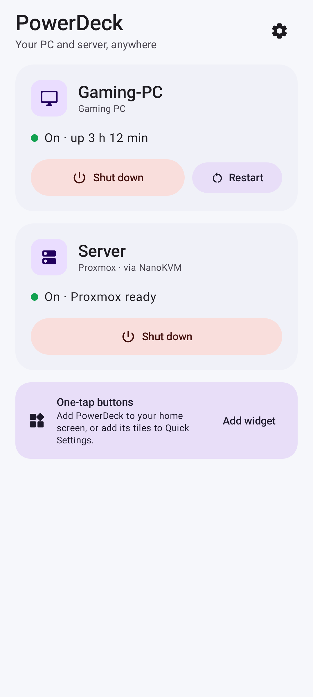
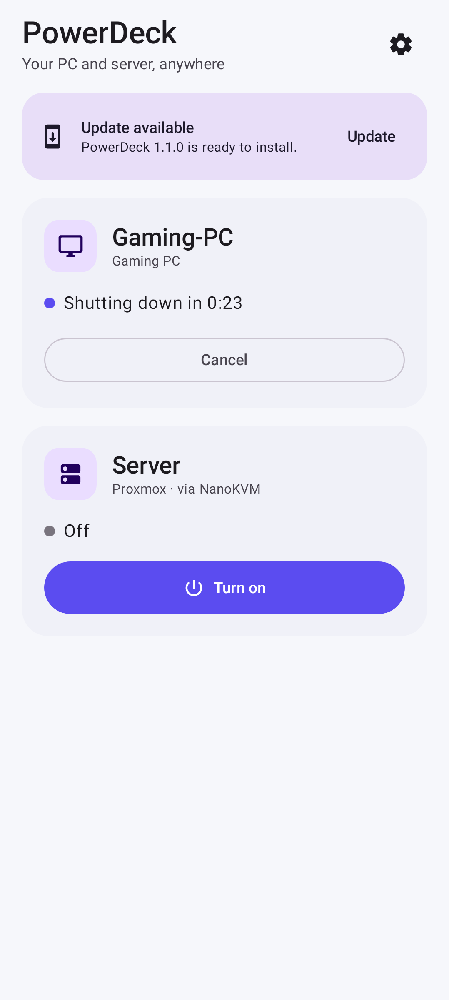
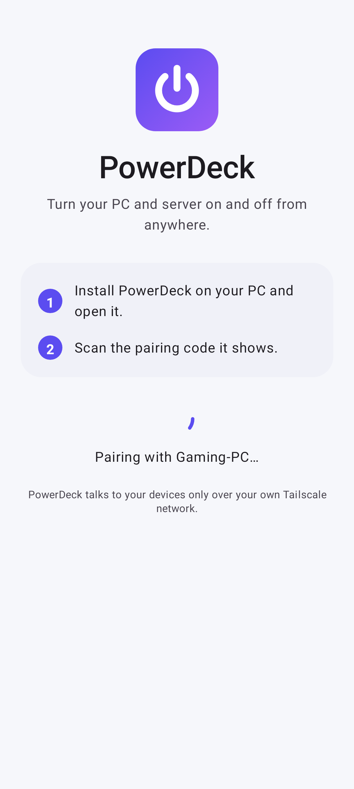

<p align="center"></p>

<h1 align="center">PowerDeck</h1>

<p align="center">Turn your PC and your server on and off from your phone, from anywhere.</p>

<p align="center">
  <a href="https://github.com/ProjectZero02/powerdeck/releases/latest"></a>
  <a href="https://github.com/ProjectZero02/powerdeck/actions/workflows/build.yml"></a>
  <a href="LICENSE"></a>
</p>

<p align="center">
  
  
  
  
</p>

---

PowerDeck is two small apps:

- **PowerDeck for Windows** runs quietly in the background on your PC. It lets your paired phone shut the PC down or restart it, and it shows the code that pairs your phone.
- **PowerDeck for Android** shows whether your PC and server are on, with one big button for each. It also gives you a home-screen widget and Quick Settings tiles.

It works anywhere your phone has internet, over your own [Tailscale](https://tailscale.com) network. Nothing is exposed to the internet.

| What | How |
|---|---|
| **Turn the PC on** | A Wake-on-LAN signal, sent by your NanoKVM from inside your home network |
| **Shut down or restart the PC** | The PowerDeck service on the PC (30-second warning, cancellable) |
| **Turn the server on or off** | Your NanoKVM presses the server's power button. A short press means a clean OS shutdown, and PowerDeck checks the power light first so it never toggles the wrong way |

## Install

**You need:** Tailscale on the PC and on the phone, both signed in to the same tailnet. Server control also needs a [NanoKVM](https://github.com/sipeed/NanoKVM) wired to the server's power button and power light.

1. **On the PC:** download **[PowerDeck-Setup.exe](https://github.com/ProjectZero02/powerdeck/releases/latest/download/PowerDeck-Setup.exe)** and run it. Approve the admin prompt.
   PowerDeck sets itself up and opens a window with two QR codes.
2. **On the phone:** scan the first QR code ("Get the app") with the camera and install **PowerDeck.apk**.
   Android asks you once to allow installing apps from your browser.
3. **In the app:** tap **Scan pairing code** and scan the second QR code.
   Then enter your NanoKVM password once. Your password manager can fill it in.

That's it. Add the widget or the Quick Settings tiles for one-tap control.

> **First run on Windows:** the installer isn't code-signed yet, so SmartScreen may say "Windows protected your PC". Choose **More info → Run anyway**. Every release is built by GitHub Actions from this repository.

### What the installer sets up on the PC

- A **Windows service** ("PowerDeck") that starts with Windows, before anyone signs in.
- A **firewall rule** that admits only Tailscale addresses (`100.64.0.0/10`) to PowerDeck's port.
- **Wake-on-LAN** on your wired network card, and **Fast Startup off**, so "shut down" is a real cold shutdown the card can wake from.
- **Tailscale unattended mode**, so the PC is reachable at the sign-in screen after it wakes up.
- A **Start menu** entry that reopens the PowerDeck window to pair more phones or remove one.

Your BIOS needs Wake-on-LAN enabled too. On ASUS boards that's *ErP Ready: Disabled* and *Power On By PCI-E: Enabled*.

### Updates

Both apps update themselves from the [releases](https://github.com/ProjectZero02/powerdeck/releases):

- **Windows** installs updates automatically. You can turn this off in the PowerDeck window. Each installer is checked against an Ed25519 signature before it runs.
- **Android** shows an "Update available" card. Android itself refuses any update that isn't signed with the same key as the installed app.

### Checking a download

Every release lists SHA-256 checksums in `SHA256SUMS.txt` and carries a GitHub build attestation, so you can confirm a file was built by this repository's CI:

```
gh attestation verify PowerDeck-Setup.exe --repo ProjectZero02/powerdeck
```

## Troubleshooting

| Problem | Try |
|---|---|
| The app says the PC is off, but it's on | Check Tailscale is connected on both. In the PowerDeck window on the PC, all setup checks should be green |
| "Turn on" does nothing | Wake-on-LAN must be enabled in the BIOS, and the PC must be wired (Wi-Fi can't wake). Do a full shutdown from PowerDeck once so Windows leaves the network card armed |
| The PC is unreachable after waking | Turn on **Run unattended** in the Tailscale tray menu, so Tailscale connects before anyone signs in |
| The server doesn't respond | Check **Settings → Server (NanoKVM)** says "Connected", and that the NanoKVM is on your tailnet |
| Pairing code expired | Codes last 10 minutes. Click **New code** in the PowerDeck window |

The Windows log is at `C:\ProgramData\PowerDeck\logs\powerdeck.log`.

## Security

- **Pairing** works like linking WhatsApp Web. The QR code carries a one-time code (valid 10 minutes, single use, 5 wrong guesses and it's gone) and the PC's certificate fingerprint. The phone gets its own long random token. The PC stores only a hash of it, and you can revoke it from the PC.
- **Phone ↔ PC** traffic is HTTPS (TLS 1.3) pinned to that PC's own certificate, so another device can't pretend to be your PC. It also runs inside Tailscale's WireGuard tunnel. The PC only answers tailnet addresses, and it throttles repeated failures.
- **The NanoKVM password** stays on the phone, encrypted with a key held in Android's hardware-backed keystore. It's never sent to the PC or anywhere else. The app is excluded from backups.
- **The PC window** is served on `127.0.0.1` only. It's protected against DNS rebinding and against other websites calling it.

Details: [SECURITY.md](SECURITY.md) · protocol: [docs/protocol.md](docs/protocol.md)

## Building

| Part | Stack | Test |
|---|---|---|
| `windows/` | Go 1.27, no CGO. The installer is Inno Setup | `go test ./...` · `go run ./tools/demo` shows the PC window with sample data |
| `android/` | Kotlin, Jetpack Compose (Material 3), Glance widget, AGP 9 | `./gradlew testDebugUnitTest` (unit tests plus Roborazzi screenshots) |

CI ([`.github/workflows/build.yml`](.github/workflows/build.yml)) runs all tests. It also installs, upgrades and uninstalls the real installer on a Windows VM, and renders every screen. Pushing a tag `vX.Y.Z` publishes a signed release.

## Contributing

See [CONTRIBUTING.md](CONTRIBUTING.md).

## License

[MIT](LICENSE)
